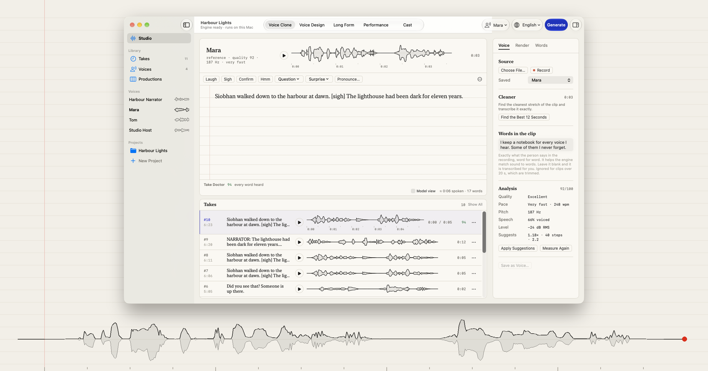
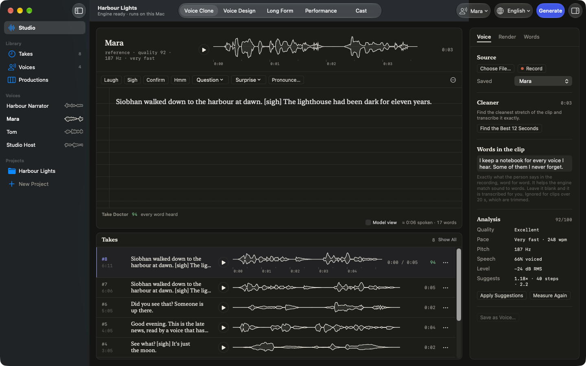
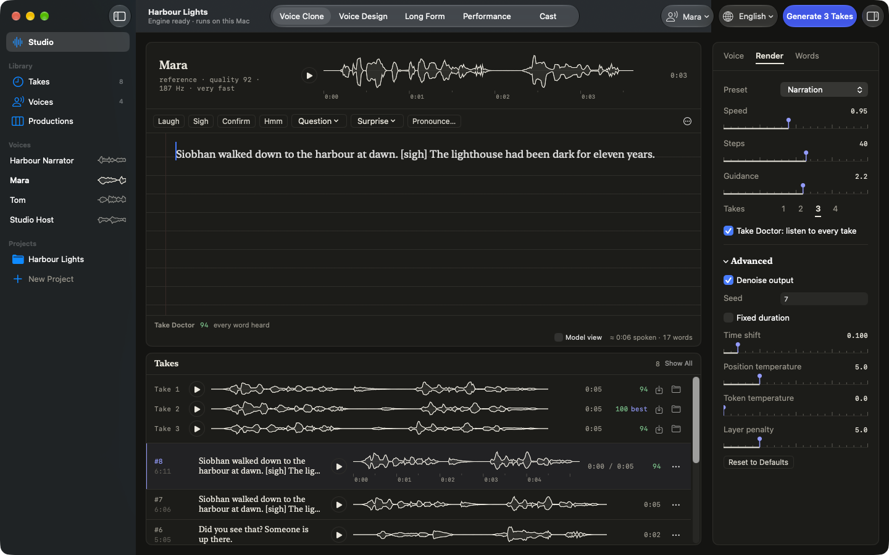
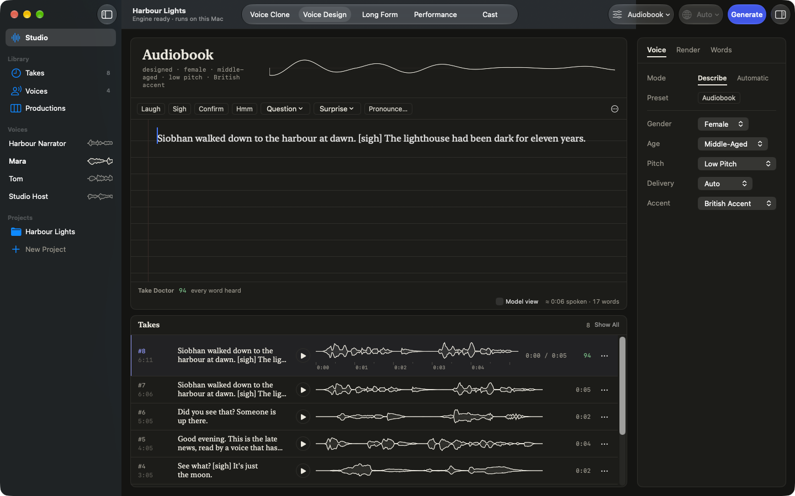
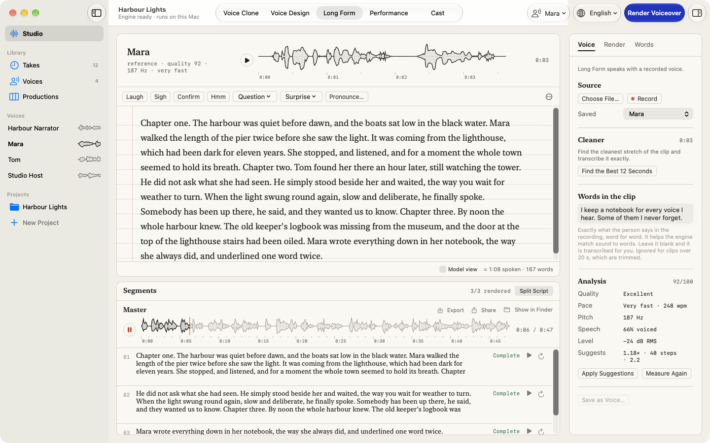
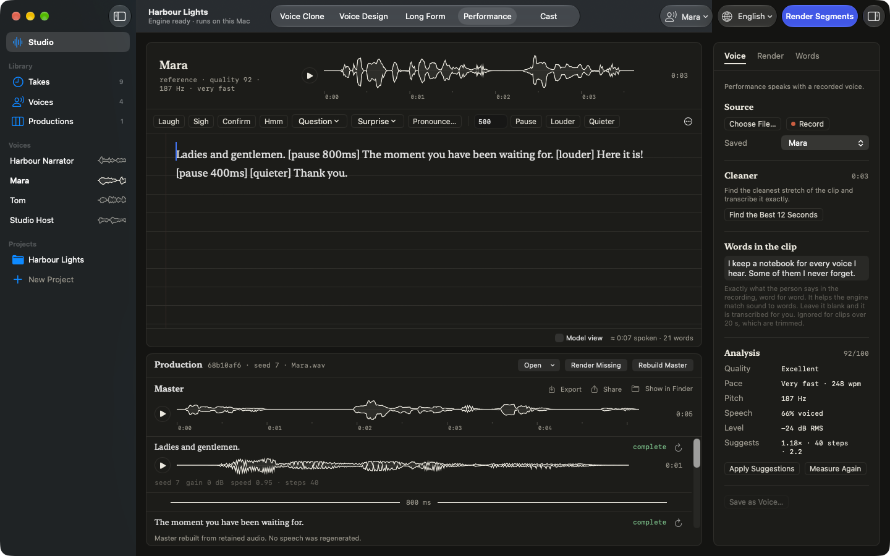
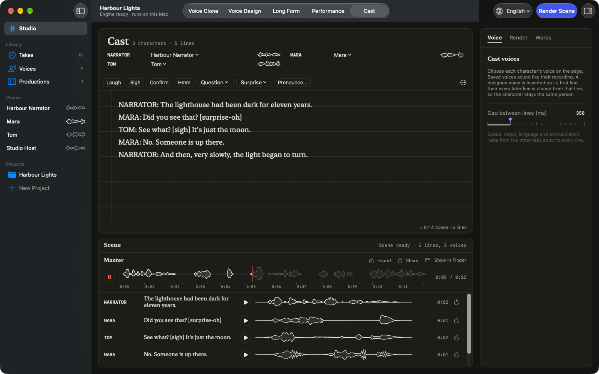
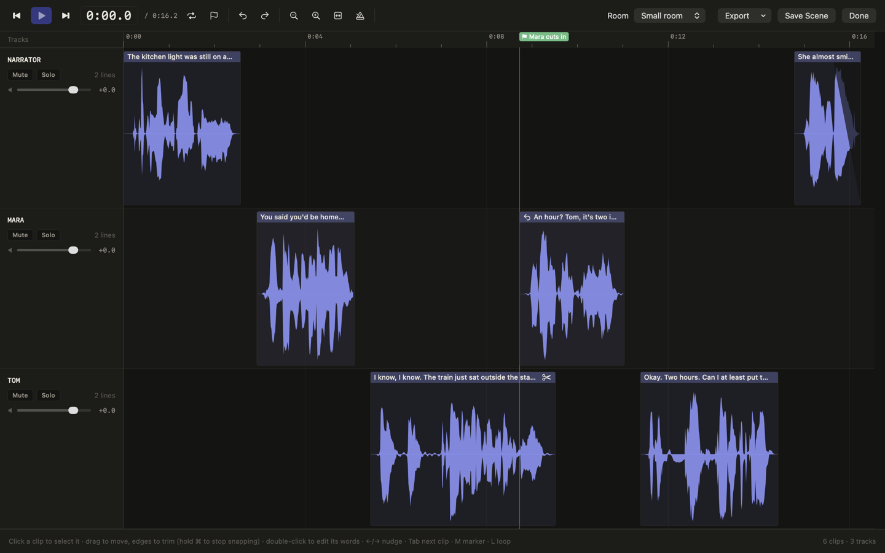
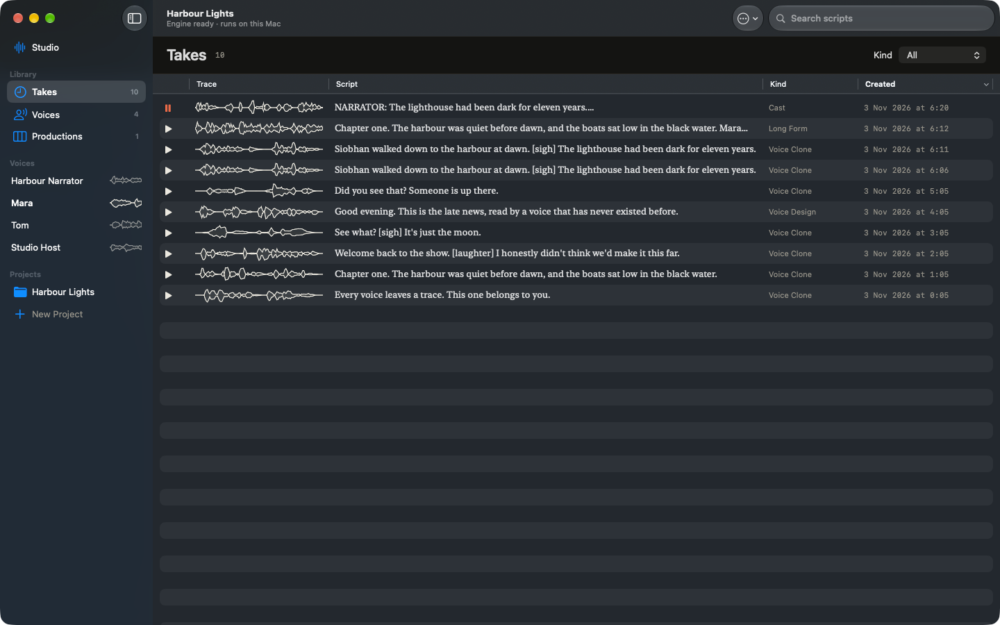

[](docs/images/3.8/hero.png)

# VoxAster

**A local AI voice studio for macOS.** Every voice leaves a trace.

Design a voice, clone one from a reference, cast a whole scene, edit it on a multitrack timeline and fix the words that came out wrong — in one native macOS studio.

**Apple Silicon · macOS 14+ · Local processing**

[Get started](#get-started) · [New in 3.8.2](#new-in-382) · [Inside the studio](#inside-the-studio) · [Capabilities](#what-you-can-make) · [Privacy](#local-processing-and-privacy) · [Model licences](#models-and-licensing) · [Documentation](docs/README.md)

> **Source-only · 3.8.2.** Build locally; no official app download is provided. [Release setup](#get-started) · [Managed setup on main](docs/RUNTIME_BOOTSTRAP.md) · [Model terms](#models-and-licensing). Models and dependencies are downloaded separately under their own licence terms.

## New in 3.8.2

A polish release: fixes from a full QA pass, and a few things that were missing.

- **Long Form: Rebuild Master.** Retry a single segment, then join the segments you already have into a new master in seconds. Before, a new master meant rendering every segment again, which changed the ones you liked.
- **Every take is kept.** All 2–4 takes from a multi-take generation now go into Takes and the open project, instead of disappearing at the next generation.
- **Scene Editor.** Drag along the ruler to scrub the playhead; hold **⇧** while dragging to set a loop. Clear a loop with its **✕**, the loop button, **L** or **Esc**. The playhead keeps its place after an edit, and clicking empty track space while paused moves it there.
- **Cast gap.** Changing **Gap between lines** on a rendered scene moves the lines to match, keeping your timeline edits, interruptions and talk-overs (one undo step).
- **Safer.** Deleted voices and scenes go to the Trash. **Clear All Takes** asks first. **New Scene** and **Open Scene** offer to save a scene you haven't saved. **Clear Script** and **Replace with Clipboard** can be undone with **⌘Z**.
- **Clearer errors.** An invalid setting names the setting and its range, for example "Fixed duration must be more than 0 and at most 600 seconds".
- **Fixes.**
  - Play buttons in the Library and Studio now switch to pause.
  - The Record menu shows **Stop Recording** while recording.
  - Only one sound plays at a time.
  - Long Form splits at `?`, `!` and `…` as well as full stops, and breaks over-long sentences.
  - Re-rendering a Cast line keeps its fades.
  - Waveform lists no longer re-read audio files many times a second during playback.

### Upgrading from 3.8.1

Voices, takes, projects, drafts, Performance productions and Cast scenes carry over. A **managed runtime** needs **Settings → Engine → Set Up or Repair Runtime** once, because its lock records the app version; repair reuses the verified downloads it has already kept. No model or package changed.

### Earlier in 3.8

- **3.8.1** added the **Scene Editor** (a multitrack timeline for Cast), interruptions with `--` and `>>`, a shared **Room**, the optional **Together** engine (MOSS-TTSD), Whisper line checks, loudness, stem and subtitle exports, and Scenes in the Library.
- **3.8.0** brought the single studio window, the **Reference Cleaner**, **Take Doctor** and **Cast**, and fixed generation freezing on long references.

The [changelog](CHANGELOG.md) has the full details.

## Inside the studio

Real VoxAster 3.8 windows from a demo profile; the Scene Editor is the app's own view rendered from 3.8.1 with a demo scene. The layout is unchanged in 3.8.2. Every voice in them was invented with Voice Design, so no real person's voice and no personal recordings appear. The app follows your Mac's light or dark appearance. Select an image for full size.

### Voice Clone

[](docs/images/3.8/voice-clone.png)

Drop a short reference onto the voice plate, write on the ruled page and press **⌘G**. The inspector holds the reference's exact words, its measured quality, pitch and pace, and the **Reference Cleaner** for long clips. Every take lands in the roll beneath the page.

### Take Doctor

[](docs/images/3.8/take-doctor.png)

Ask for up to four takes with different seeds. Take Doctor transcribes each one on your Mac, scores it against the script and marks the best. A wrong or missing word is underlined in the script; re-render just that sentence and it is spliced back into the take, or add a pronunciation rule in one click.

### Voice Design

[](docs/images/3.8/voice-design.png)

Describe a speaker with the model's supported attributes, start from a preset such as Audiobook, or let Auto choose. With no recording to draw, a designed voice gets a drawn signature of its own.

### Long Form

[](docs/images/3.8/long-form.png)

Paste a chapter, an article or a narration. It is split at sentence boundaries into segments you can edit and re-render one by one, then joined into a single master. After re-rendering a segment, **Rebuild Master** joins the segments you have without rendering any again.

### Performance

[](docs/images/3.8/performance.png)

Place exact pauses and louder or quieter passages, prepare a production, and re-render any single segment with its original seed. Pauses are drawn as a flat line with their exact length. These directions change timing and loudness, not emotional acting.

### Cast

[](docs/images/3.8/cast.png)

Write `NAME: line` and give each character a saved or designed voice. The scene renders with live progress; a failed line is retried once and the rest carry on, and **Retry Failed** finishes the job. Choose a **Room** so every voice sits in the same space, then **Open Scene Editor**.

### Scene Editor

[](docs/images/3.8/scene-editor.png)

A full-window multitrack timeline in the style of Audacity. Drag clips to move them and their edges to trim; hold **⌘** to stop snapping. Double-click a clip to change its words. Drag along the ruler to scrub the playhead, and hold **⇧** while dragging to set a loop. Drop markers with **M**, and use **Pace** to tighten every gap at once. Export the mix at a loudness target, one stem per character, or subtitles.

| Keys | Action |
|---|---|
| **Space** | Play or pause |
| **← / →** | Nudge the selected clip 50 ms (**⇧** for 10 ms), or move the playhead 1 s |
| **Tab / ⇧Tab** | Select the next or previous clip |
| **⌘Z / ⇧⌘Z** | Undo / redo |
| **⌘+ / ⌘−** | Zoom in / out |
| **Home / End** | Jump to the start / end |
| **M** | Add a marker at the playhead |
| **L** | Loop the selected clip (or 4 s from the playhead); press again to clear the loop |
| **Esc** | Clear the loop, then the selection, then close the editor |

### Library

[](docs/images/3.8/library.png)

Takes, voices, Performance productions and Cast scenes each have a Library table; Takes can be sorted and searched. Double-click to play or to use a voice; right-click to export, reveal, or move to the Trash. Projects keep their own takes.

## What you can make

| Mode or tool | What it does |
|---|---|
| **Voice Clone** | Generate new speech from a reference recording and save voices for reuse. Record a reference directly on your Mac or import a permitted clip. |
| **Voice Design** | Create a speaker from the model's supported gender, age, pitch and accent attributes or a preset, or let Auto choose a voice. |
| **Long Form** | Split a longer script into editable segments, retry any one and rebuild the master from the segments you keep. |
| **Performance** | Insert exact pauses, adjust segment loudness, retry individual segments and rebuild a master from retained takes. |
| **Cast** | Render a multi-character script, one voice per character, into a single scene in a shared room. Mark interruptions with `--` and `>>`; save scenes to the Library. |
| **Scene Editor** | Arrange a scene on a multitrack timeline: move, trim, fade and re-level lines, mute or solo characters, add markers and loops, and export the mix, stems or subtitles. |
| **Together engine** | Optional. Perform short passages of dialogue in one pass with MOSS-TTSD, so voices react to each other. |
| **Reference Cleaner** | Find and transcribe the cleanest short stretch of a long reference. |
| **Take Doctor** | Score each take against its script, underline wrong or missing words and repair a single sentence. |
| **Pronunciation** | Handle names and specialist terms with a replacement dictionary, English CMU phonemes and Chinese pinyin overrides. Insert supported vocal events at the cursor. |
| **Takes, Library and projects** | Generate up to four takes with different seeds, browse takes, voices, productions and scenes in the Library, organize projects and recover editable drafts between sessions. |
| **Engine Lab** | Compare two installed engines blind on the same reference and script. |

### From a script to a finished take

Start with a designed voice or a reference recording. Hear a few takes, let Take Doctor point out the words that need attention, and re-render only the sentence that missed. For longer pieces, edit a segment or retry a Performance segment without starting the whole production again; for dialogue, give each character a voice in Cast and finish the scene in the Scene Editor.

Generation runs on your Mac through the separate [OmniVoice](https://github.com/k2-fsa/OmniVoice) model. VoxAster brings its controls into a native SwiftUI workspace alongside playback, WAV export and production tools. It is an independent app, not an official k2-fsa product.

Performance controls change **timing and audio loudness**, not emotional acting. Pause/Louder/Quieter buttons insert the app's supported directions; native vocal events are separate model-supported sounds. See [script controls and examples](docs/CONTROLS.md) for exact syntax and boundaries.

## Local binary preparation

### Managed setup on `main`

Current `main` includes a validated managed first-run setup that installs the pinned runtime and models. After VoxAster itself has been built from source, this setup does not require users to separately install Homebrew, Python, Git, FFmpeg or Xcode.

VoxAster remains source-only: users must build the app themselves, and no official downloadable app or signed/notarized binary is provided. A managed runtime needs **Settings → Engine → Set Up or Repair Runtime** once after each app update, because the runtime lock records the app version; repair reuses the verified downloads it has already kept.

See the [managed runtime design and artifact catalogue](docs/RUNTIME_BOOTSTRAP.md).

## Get started

### Requirements

- An **Apple Silicon Mac running macOS 14 or newer**.
- **Xcode Command Line Tools**, including Swift and the macOS SDK.
- **Homebrew**, **Python 3.12**, **Git** and **FFmpeg**.
- Optional, for the Together engine: **Python 3.13** and about 10 GB more storage.
- Internet access for initial dependency/model downloads and several GB of available storage. Setup time varies with your Mac, connection and cache; no minimum RAM guarantee has been established.

Intel Macs, Windows and Linux are not supported by this native app. Voice Design can be your first workflow without a recording; cloning requires a voice/reference you are authorized to use. Microphone permission is needed only when recording.

### Build and open the released version

1. Install Apple's command-line tools if you do not already have them. Finish any macOS installation prompt before continuing:

   ```sh
   xcode-select --install
   ```

2. With [Homebrew](https://brew.sh/) installed, obtain the prerequisites:

   ```sh
   brew install python@3.12 ffmpeg git
   ```

3. Download the tagged 3.8.2 source, prepare the runtime, then build and open VoxAster:

   ```sh
   git clone --branch v3.8.2 --single-branch https://github.com/ninja8170/VoxAster.git
   cd VoxAster
   ./setup-runtime.command
   ./verify-runtime.command
   ./build.command
   open .build/VoxAster.app
   ```

   Setup downloads the pinned dependencies and models; it does not install an app into Applications. It creates a per-user runtime and refuses to overwrite an existing one. **Already used OmniVoice/VoxAster on this Mac?** Follow the [existing-runtime instructions](docs/GETTING_STARTED.md#existing-runtime) instead of repeating setup.

4. Wait for **Engine ready** under the window title. Choose **Voice Design** in the toolbar, pick attributes or a preset in the inspector, press **Use this example** in the empty script (or write your own) and press **⌘G**. For **Voice Clone**, drop a short, clean reference onto the voice plate; for a long clip, use **Find the Best 12 Seconds** in the inspector. Listen, refine and export a WAV.

Local builds are ad-hoc signed, **not Developer ID signed or notarized**. Do not disable Gatekeeper globally. See [setup details, optional installation and runtime pins](docs/GETTING_STARTED.md) for the source-archive route, shared data locations and troubleshooting.

### Together engine (optional)

Cast's **Together** engine uses [MOSS-TTSD](https://github.com/OpenMOSS/MOSS-TTSD) through [mlx-speech](https://pypi.org/project/mlx-speech/). It runs in its own Python 3.13 environment, separate from VoxAster's runtime, and downloads about 10 GB at pinned revisions:

```sh
brew install python@3.13
./setup-moss.command
```

Then choose **Engine › Together** in Cast's inspector. Without it, Cast renders line by line as before. Pronunciation rules and language settings don't apply to Together passages.

## Local processing and privacy

VoxAster sends scripts and reference audio to its **local backend on your Mac** for generation and transcription. Take Doctor, the Reference Cleaner and Cast's line checks transcribe with Whisper on the same local backend. The optional Together engine runs MOSS-TTSD on your Mac in a separate local process. The audited processing paths do not upload voice/audio to an external speech service. No application analytics or crash-upload system was found in the release audit; macOS diagnostics are separate.

Internet access is used where documented to download dependencies and models. Whisper (used for automatic reference transcription, the Cleaner, Take Doctor and Cast line checks) is downloaded when first needed, and loading it may check Hugging Face for a newer copy of the model; no audio is sent. The optional `setup-moss.command` downloads `mlx-speech` and the pinned MOSS models; the Together engine then runs offline. Offline workflows require all their assets to be cached first.

Your Library, History, projects, drafts and recordings are local user data; they are not shipped with the source or app bundle. The app is not sandboxed, and legacy storage names are preserved for existing users. [Read the privacy and storage details](PRIVACY.md).

## Models and licensing

**The app's MIT licence does not override model terms.** Free download does not imply unrestricted commercial use.

| Component | Licence boundary |
|---|---|
| **VoxAster original code and icons** | [MIT](LICENSE). |
| **OmniVoice synthesis code** | Apache-2.0, from the upstream project. |
| **OmniVoice model weights** | Separate CC-BY-NC terms; downloaded by the user, not bundled. |
| **Boson Higgs Audio 2 audio tokenizer** | Boson Higgs Audio 2 Community License, incorporating Meta Llama 3 licence and acceptable-use terms. Official source, pinned revision and verified hashes. |
| **MOSS-TTSD and MOSS audio tokenizer (optional)** | Apache-2.0, MLX conversions run through mlx-speech (MIT). Installed only by `setup-moss.command`; not bundled. |

See [THIRD_PARTY.md](THIRD_PARTY.md) for full distinctions, required notices and optional dependencies. Training, LoRA/fine-tuning and dataset token extraction are not included. Higgs materials/outputs must not be used to improve other large language models. Boson requires separate permission above 100,000 annual active users across your/affiliates' products or services in the preceding calendar year; other licence and acceptable-use conditions also apply.

### Required model attribution

Built with Higgs Materials licensed from Boson AI USA, Inc., Copyright Boson AI USA, Inc., All Rights Reserved and Meta Llama 3 licensed under the Meta Llama 3 Community License, Copyright Meta Platforms, Inc., All Right Reserved.

Built with Meta Llama 3; based on Meta Llama 3.

The [Boson agreement](Licenses/BOSON-HIGGS-AUDIO-2.txt), [Meta agreement and acceptable-use policy](Licenses/META-LLAMA-3.txt) and [Notice](Notice) accompany this source and built app. These restricted community licences are not MIT, Apache-2.0 or unrestricted open-source terms. Use only voices and recordings you are authorized to use.

## Help and development

- **Setup or startup problems?** See [troubleshooting](docs/GETTING_STARTED.md#troubleshooting).
- **Pronunciation, pauses, vocal events or Cast interruptions?** Read [script controls](docs/CONTROLS.md). Unsupported acting tags are rejected; Markdown is not acting direction.
- **Contributing?** Read [CONTRIBUTING.md](CONTRIBUTING.md). Run `./test.command`, `./verify-runtime.command` and `git diff --check` for code changes. Real listening acceptance remains separate from automated tests.
- **Reporting a problem?** Use [Issues](https://github.com/ninja8170/VoxAster/issues) with non-sensitive examples. Report vulnerabilities through the guidance in [SECURITY.md](SECURITY.md).
- **Documentation:** [all guides and references](docs/README.md). **Release history:** [CHANGELOG.md](CHANGELOG.md). **App licence:** [MIT](LICENSE).
