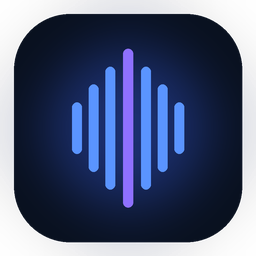
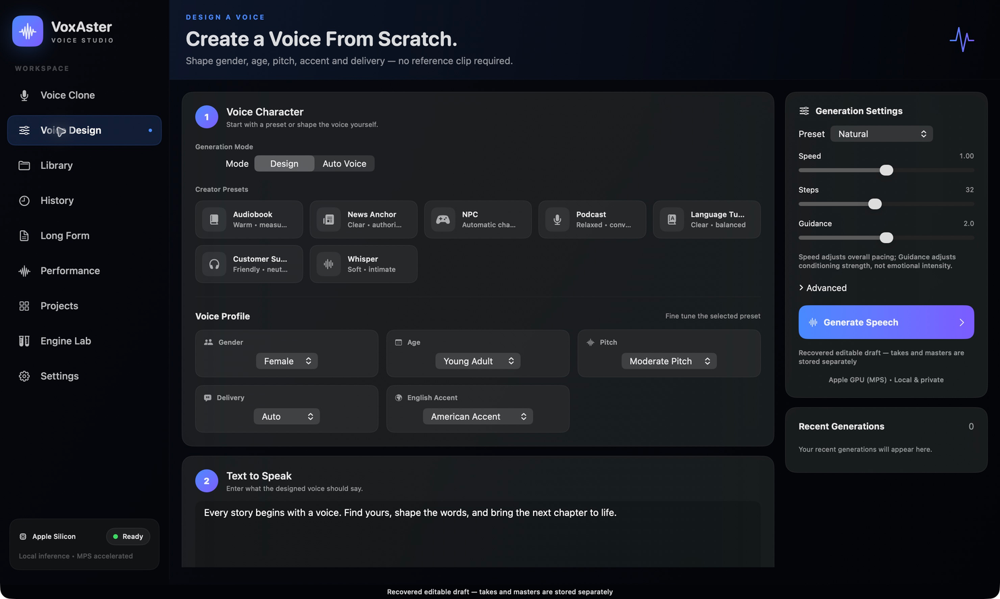
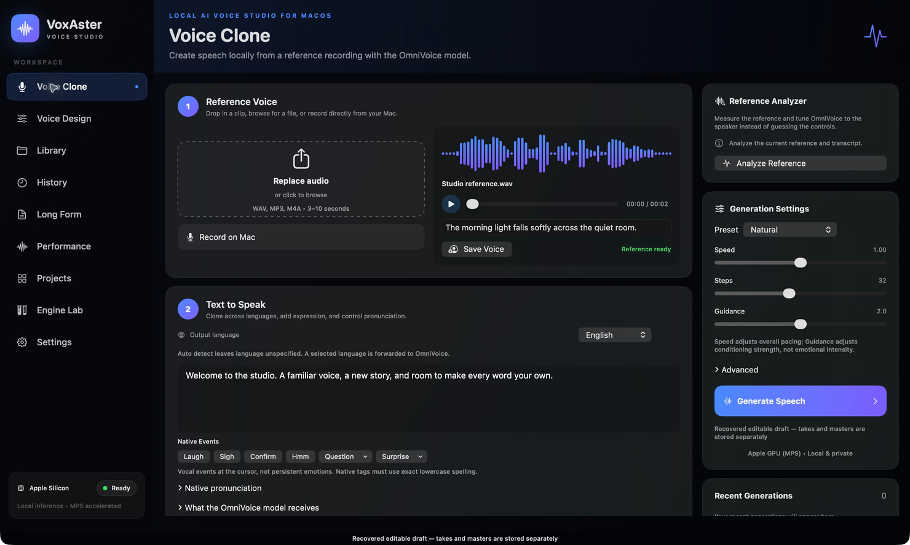
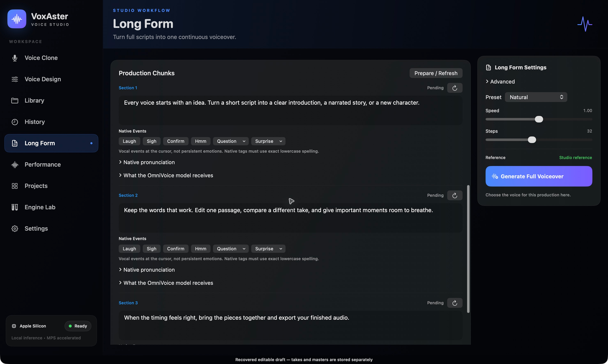
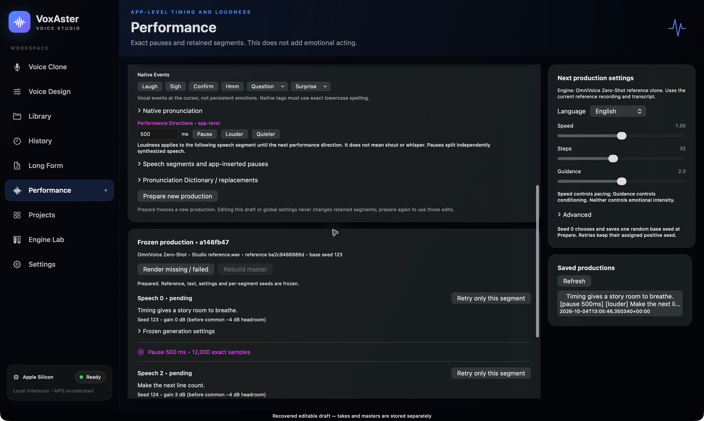

<p align="center">
  
</p>

# VoxAster

**Local AI Voice Studio for macOS**

VoxAster is a native macOS studio for local AI voice generation, cloning and long-form voice production. Design a speaker, shape pronunciation, compare takes and build a finished performance with deliberate pauses and segment loudness controls.

**Apple Silicon · macOS 14+ · Version 3.7.0**

[Get started](#get-started) · [What you can make](#what-you-can-make) · [Screenshots](#inside-the-studio) · [Privacy](#local-processing-and-privacy) · [Model licences](#models-and-licensing)

> **Build from source:** there is currently no official downloadable `.app` or installer. The [3.7.0 release](https://github.com/ninja8170/VoxAster/releases/tag/v3.7.0) contains source code. Required models and dependencies are downloaded separately and have their own licence terms.



*Voice Design: choose supported speaker attributes and start without a reference recording.*

## What you can make

| Workspace | What it does |
|---|---|
| **Voice Design** | Create a speaker using the model's supported gender, age, pitch and accent attributes, or let Auto Voice choose a voice. |
| **Voice Clone** | Generate new speech from a reference recording and save voices for reuse. Record a reference directly on your Mac or import a permitted clip. |
| **Pronunciation** | Handle names and specialist terms with a replacement dictionary, English CMU phonemes and Chinese pinyin overrides. Insert supported vocal events from the editor. |
| **Long Form** | Break a longer script into editable production chunks and retry the selected chunk. |
| **Performance** | Insert exact pauses, adjust segment loudness, retry individual segments and rebuild a master from retained takes. |
| **Takes and projects** | Compare generation variants, organize projects and recover editable drafts between sessions. |

### From a script to a finished take

Start with a designed voice or a reference recording. Hear a few variants, keep what works and refine the words that need attention. For longer pieces, edit a chunk or retry a Performance segment without starting the whole production again.

Generation runs on your Mac through the separate [OmniVoice](https://github.com/k2-fsa/OmniVoice) model. VoxAster brings its controls into a native SwiftUI workspace alongside playback, WAV export and production tools. It is an independent app, not an official k2-fsa product.

Performance controls change **timing and audio loudness**, not emotional acting. Pause/Louder/Quieter buttons insert the app's supported directions; native vocal events are separate model-supported sounds. See [script controls and examples](docs/CONTROLS.md) for exact syntax and boundaries.

## Inside the studio

Screenshots show the real 3.7.0 app with demo scripts and a synthetic reference, not personal recordings or projects. Click an image to view it at full size.

### Voice Clone

Import a reference, supply its transcript and shape the next take with pronunciation and generation controls.



### Long Form

Edit production chunks individually and retry the section that needs another take.



### Performance

Prepare speech segments with fixed settings, deliberate pauses and independent retries. This view shows a prepared production before rendering; rebuilding a master becomes available once its speech segments have audio.



[Image provenance and capture details](docs/images/README.md).

## Get started

### Requirements

- An **Apple Silicon Mac running macOS 14 or newer**.
- **Xcode Command Line Tools**, including Swift and the macOS SDK.
- **Homebrew**, **Python 3.12**, **Git** and **FFmpeg**.
- Internet access for initial dependency/model downloads and several GB of available storage. Setup time varies with your Mac, connection and cache; no minimum RAM guarantee has been established.

Intel Macs, Windows and Linux are not supported by this native app. Voice Design can be your first workflow without a recording; cloning requires a voice/reference you are authorized to use. Microphone permission is needed only when recording.

### Build and open the released version

1. Install Apple's command-line tools if you do not already have them. Finish any macOS installation prompt before continuing:

   ```sh
   xcode-select --install
   ```

2. With [Homebrew](https://brew.sh/) installed, obtain the prerequisites:

   ```sh
   brew install python@3.12 ffmpeg git
   ```

3. Download the tagged 3.7.0 source, prepare the runtime, then build and open VoxAster:

   ```sh
   git clone --branch v3.7.0 --single-branch https://github.com/ninja8170/VoxAster.git
   cd VoxAster
   ./setup-runtime.command
   ./verify-runtime.command
   ./build.command
   open .build/VoxAster.app
   ```

   Setup downloads the pinned dependencies and models; it does not install an app into Applications. It creates a per-user runtime and refuses to overwrite an existing one. **Already used OmniVoice/VoxAster on this Mac?** Follow the [existing-runtime instructions](docs/GETTING_STARTED.md#existing-runtime) instead of repeating setup.

4. Wait for **Ready**, then open **Voice Design** to choose supported voice attributes, enter a short script and generate a first take. For **Voice Clone**, select a clean reference and provide its transcript to avoid an optional transcription-model download. Listen, refine and export a WAV.

Local builds are ad-hoc signed, **not Developer ID signed or notarized**. Do not disable Gatekeeper globally. See [setup details, optional installation and runtime pins](docs/GETTING_STARTED.md) for the source-archive route, shared data locations and troubleshooting.

## Local processing and privacy

VoxAster sends scripts and reference audio to its **local backend on your Mac** for generation and transcription. The audited processing paths do not upload voice/audio to an external speech service. No application analytics or crash-upload system was found in the release audit; macOS diagnostics are separate.

Internet access is used where documented to download dependencies and models. Optional reference transcription may download Whisper when first needed. Offline workflows require all their assets to be cached first.

Your Library, History, projects, drafts and recordings are local user data; they are not shipped with the source or app bundle. The app is not sandboxed, and legacy storage names are preserved for existing users. [Read the privacy and storage details](PRIVACY.md).

## Models and licensing

**The app's MIT licence does not override model terms.** Free download does not imply unrestricted commercial use.

| Component | Licence boundary |
|---|---|
| **VoxAster original code and icons** | [MIT](LICENSE). |
| **OmniVoice synthesis code** | Apache-2.0, from the upstream project. |
| **OmniVoice model weights** | Separate CC-BY-NC terms; downloaded by the user, not bundled. |
| **Boson Higgs Audio 2 audio tokenizer** | Boson Higgs Audio 2 Community License, incorporating Meta Llama 3 licence and acceptable-use terms. Official source, pinned revision and verified hashes. |

See [THIRD_PARTY.md](THIRD_PARTY.md) for full distinctions, required notices and optional dependencies. Training, LoRA/fine-tuning and dataset token extraction are not included. Higgs materials/outputs must not be used to improve other large language models. Boson requires separate permission above 100,000 annual active users across your/affiliates' products or services in the preceding calendar year; other licence and acceptable-use conditions also apply.

### Required model attribution

Built with Higgs Materials licensed from Boson AI USA, Inc., Copyright Boson AI USA, Inc., All Rights Reserved and Meta Llama 3 licensed under the Meta Llama 3 Community License, Copyright Meta Platforms, Inc., All Right Reserved.

Built with Meta Llama 3; based on Meta Llama 3.

The [Boson agreement](Licenses/BOSON-HIGGS-AUDIO-2.txt), [Meta agreement and acceptable-use policy](Licenses/META-LLAMA-3.txt) and [Notice](Notice) accompany this source and built app. These restricted community licences are not MIT, Apache-2.0 or unrestricted open-source terms. Use only voices and recordings you are authorized to use.

## Help and development

- **Setup or startup problems?** See [troubleshooting](docs/GETTING_STARTED.md#troubleshooting).
- **Pronunciation, pauses or vocal events?** Read [script controls](docs/CONTROLS.md). Unsupported acting tags are rejected; Markdown is not acting direction.
- **Contributing?** Read [CONTRIBUTING.md](CONTRIBUTING.md). Run `./test.command`, `./verify-runtime.command` and `git diff --check` for code changes. Real listening acceptance remains separate from automated tests.
- **Reporting a problem?** Use [Issues](https://github.com/ninja8170/VoxAster/issues) with non-sensitive examples. Report vulnerabilities through the guidance in [SECURITY.md](SECURITY.md).
- **Release history:** [CHANGELOG.md](CHANGELOG.md). **App licence:** [MIT](LICENSE).
